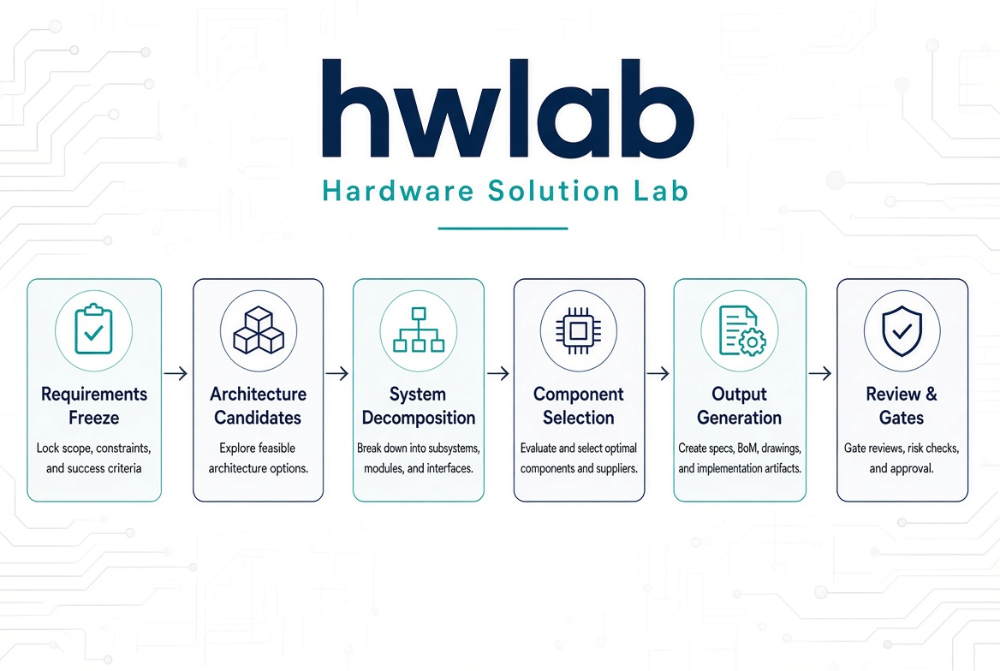

# hwlab — Hardware Solution Lab

AI agent for designing PCB hardware solutions for electronic products. Input product requirements and receive a reviewable, implementation-ready schematic-level hardware proposal.

## How to Use

Provide a requirement such as:

- Design a drone flight controller
- Design an FOC motor controller
- Design an e-ink flashcard device for vocabulary learning

The agent will automatically confirm requirements, analyze chip and architecture options from global supply chains, perform component selection, download datasheets, generate a BOM with cost estimates, produce module-level schematic fragments, and deliver a complete, actionable technical solution.



## Features

- Structured multi-stage design workflow: Requirements Freeze → Architecture Candidates → System Decomposition → Component Selection → Output Generation → Review → Verification Gates
- Three architecture candidate categories: Domestic/China-first, Overseas mainstream, and Hybrid compromise
- Multiple verification gates that catch quality issues at each stage
- Independent reviewer agent that scores proposals across Completeness, Risk Identification, Implementability, Cost Reasonableness, and Validation Coverage
- Supply-chain risk assessment with domestic (China) alternative references

- Outputs include Markdown proposals, datasheets, footprint libraries, and PDF reports

## Quick Start

In a Claude Code, Codex, or Cursor session, invoke:

```
$hardware-solution
```

Then describe your product requirements to enter the design flow.

## Installation

After installation, restart your AI IDE session so the client reloads the skill list.

### AI Installation Guide

> This section is for AI assistants (Claude Code, Codex, Cursor, etc.). When a user asks to install this plugin, guide them through the following steps.

**Step 1: Check current environment**

Run `./scripts/install.sh --status` to see if it is already installed.

**Step 2: Guide the user to choose an installation method**

Explain the three options and let the user choose:

| Method | Use case | Available components | Limitations |
|--------|----------|----------------------|-------------|
| Global install | Available in all projects | skill + agent | Hooks do not activate |
| --plugin-dir | Development, debugging, or temporary use | skill + agent + hooks | Path must be specified on each launch |
| Marketplace | Official distribution | skill + agent + hooks | Requires GitHub access |

**Step 3: Execute installation**

After the user chooses, run the corresponding command:

```bash
# Global install (Claude Code, including agent)
./scripts/install.sh --global --platform claude

# Global install (Codex, skill + agent)
./scripts/install.sh --global --platform codex

# --plugin-dir (load for a single session; skill + agent + hooks all available)
claude --plugin-dir /path/to/hwlab

# Marketplace install (replace with your published repository)
# claude plugin marketplace add <your-org>/hwlab
# claude plugin install hwlab-hardware-solution
```

If `scripts/install.sh` is unavailable (for example the repository was not cloned), follow the manual installation commands below.

**Step 4: Verify**

After installation, remind the user to restart the session, then invoke `$hardware-solution` to confirm it works.

### Interactive Installation

```bash
git clone <hwlab-repo-url>
cd hwlab
./scripts/install.sh
```

The script shows the current installation status and guides you through the options.

### Manual Installation

#### Method 1: Global Install

Copy files from the hwlab repository into the global directories so `$hardware-solution` is available in every project.

```bash
git clone <hwlab-repo-url>
cd hwlab
```

Claude Code:

```bash
# Basic install (skill)
mkdir -p "$HOME/.claude/skills"
rm -rf "$HOME/.claude/skills/hardware-solution"
cp -r skills/hardware-solution "$HOME/.claude/skills/"

# Enhanced install (also install independent reviewer agent)
mkdir -p "$HOME/.claude/agents"
cp agents/hardware-reviewer.md "$HOME/.claude/agents/"
```

Codex:

```bash
mkdir -p "$HOME/.codex/skills"
rm -rf "$HOME/.codex/skills/hardware-solution"
cp -r skills/hardware-solution "$HOME/.codex/skills/"

mkdir -p "$HOME/.codex/agents"
cp agents/hardware-reviewer.md "$HOME/.codex/agents/"
```

#### Uninstall

```bash
rm -rf "$HOME/.claude/skills/hardware-solution"
rm -f "$HOME/.claude/agents/hardware-reviewer.md"
rm -rf "$HOME/.codex/skills/hardware-solution"
rm -f "$HOME/.codex/agents/hardware-reviewer.md"
```

## Project Structure

```
hwlab/
├── skills/hardware-solution/
│   ├── SKILL.md                        # Skill entry point defining workflow and output principles
│   └── references/
│       ├── design-workflow.md           # Multi-stage design workflow
│       ├── output-template.md           # Standard proposal output structure
│       ├── verification-gates.md        # Verification gates
│       ├── review-checklists.md         # Schematic/PCB/BOM/proposal review checklists
│       ├── sourcing-and-risk.md         # Supply-chain risk assessment guide
│       └── domestic-sources.md          # China domestic chip and component references
├── agents/
│   └── hardware-reviewer.md             # Independent reviewer agent (enhanced install)
├── hooks/
│   ├── hooks.json                       # Claude Code session-start hook configuration
│   └── session-start                    # Session-start reminder script
├── scripts/
│   └── install.sh                       # Interactive install/uninstall script
├── tests/
│   └── validate.py                      # Structure and content consistency validation script
├── .claude-plugin/                      # Claude Code plugin configuration
├── .codex-plugin/                       # Codex plugin configuration
├── .cursor-plugin/                      # Cursor plugin configuration
├── CLAUDE.md                            # Claude Code / general AI session project instructions
└── AGENTS.md                            # Cursor Agent Mode / general Agent instructions
```

## Validation

After modifying the skill or reference documents, run the validation script to check structure and content consistency:

```bash
# Validate repository source files
python3 tests/validate.py

# Validate the installed copy
python3 tests/validate.py --installed
```

Validation covers three layers:

| Layer | Content |
|-------|---------|
| Structural integrity | Files exist, hooks are executable, hook output is valid JSON |
| Content consistency | SKILL.md links resolve, Gates are non-empty, output template covers Gate 4, reviewer agent covers 5 dimensions |
| Anti-pattern detection | Reference documents contain no vague wording or leftover placeholders |

## Hooks

The `hooks/` directory only activates automatically in project-level plugin mode (`.claude-plugin/plugin.json` declares `"hooks": "./hooks/"`). Global installs do not include hooks.

Manually verify hook output:

```bash
CLAUDE_PLUGIN_ROOT="$PWD" hooks/session-start | python3 -m json.tool
```

## Output Quality Requirements

- Component parameters must come from datasheets or distributor pages; never from memory
- Every key choice must explain the trade-offs; do not merely list parts
- The risk list must not be empty; high-risk items must have verification actions
- Before final delivery the proposal must pass the gates in `verification-gates.md`

## Contribution Guidelines

- Changes to skill or reference documents must include a before/after comparison
- New reference documents must be linked from the workflow section of SKILL.md
- Changes without validation against a real hardware design scenario will not be accepted
- Run `python3 tests/validate.py` before submitting to ensure it passes

## Platform Support

| Platform | Config file | Global install | Project-level plugin |
|----------|-------------|----------------|----------------------|
| Claude Code | `.claude-plugin/plugin.json` | skill + agent | skill + agent + hooks |
| Codex | `.codex-plugin/plugin.json` | skill + agent | Plugin mode not supported |
| Cursor | `.cursor-plugin/plugin.json` | skill (manual cp) | skill + agent + hooks |

## License

MIT
